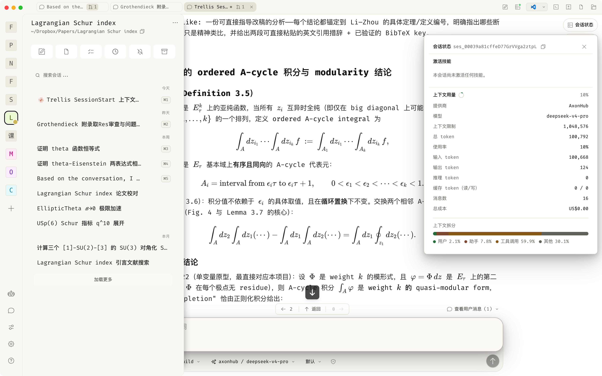
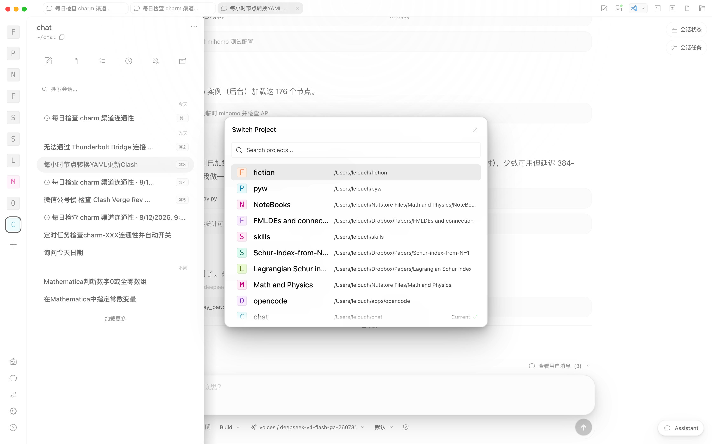
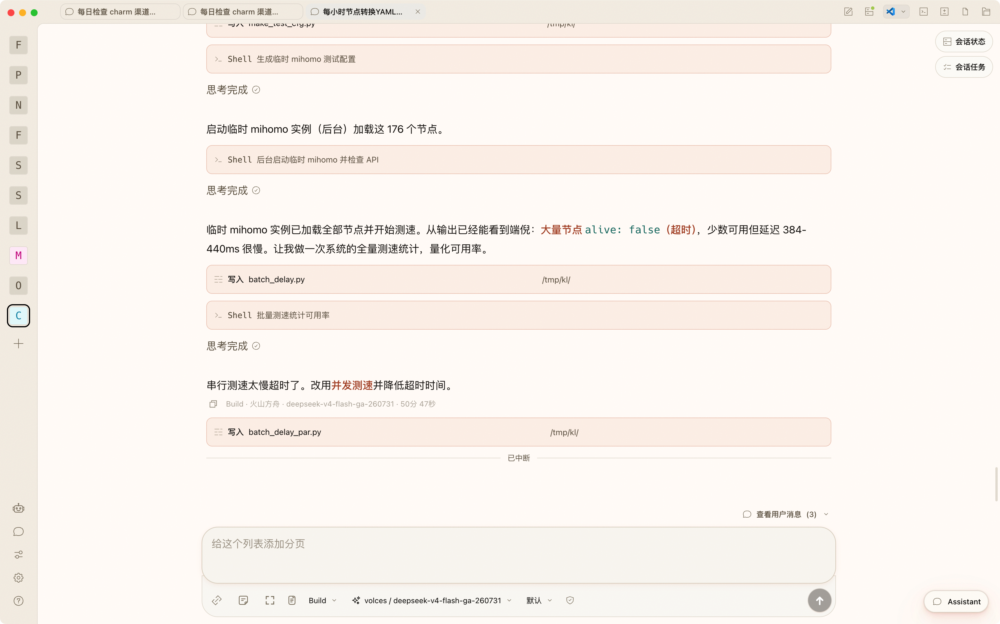
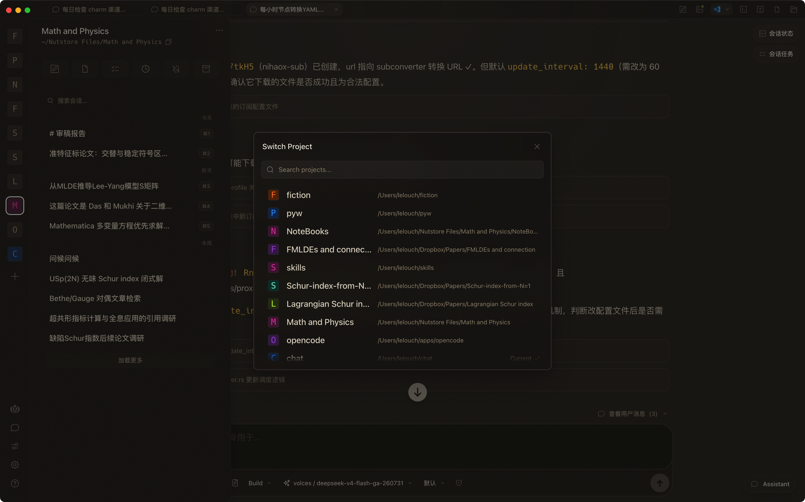
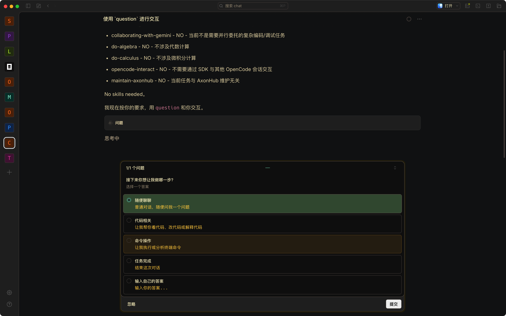
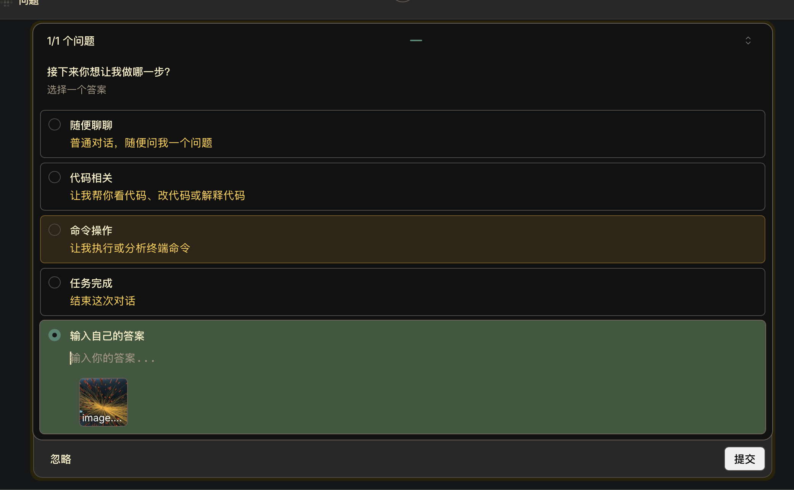
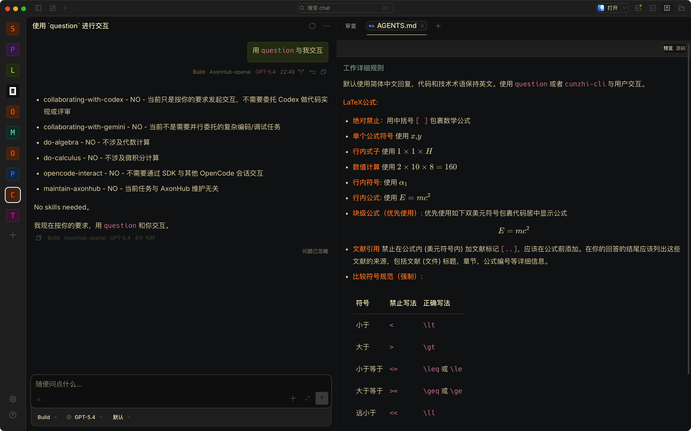
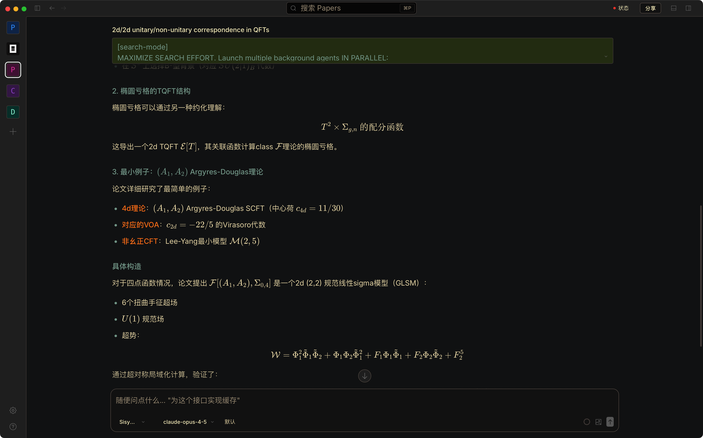
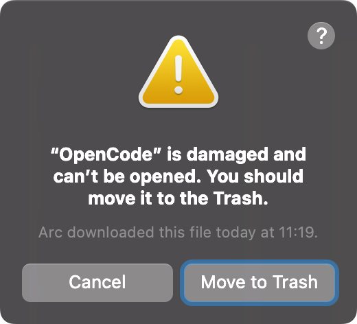

# OpenCode Studio

> 基于 [OpenCode](https://github.com/anomalyco/opencode) 的桌面应用定制版本

简体中文 | [English](docs/README.en.md)

这是一个针对 OpenCode **Desktop** 应用进行深度 UI 优化和功能增强的个人定制版本。在保持 OpenCode 核心功能的基础上，大幅改进了用户界面交互体验和使用效率。


## ✨ 主要改进


### OpenClaw、Hermes、GenericAgent 集成

<p align="center">
  
  
</p>



<p align="center">
  
  
  
</p>

#### 智能体深层功能升级

- **数学模式**: 内置了数学智能体框架 [Danus](https://github.com/frenzymath/Danus)，高效完成复杂、长程的数学任务
- **背景 shell 和智能体**: 将 shell 命令和子智能体发送到后台背景运行，完成后自动注入到主智能体的对话流；异步、优雅停止会话
- **定时任务**: 支持定时任务功能，智能体可自主创建、修改、管理
- **项目任务** 创建项目跨会话任务、会话级 Todo 层级系统，智能体可自主创建、修改、管理
- **Codex、claude、grok、dsh 外部参谋**: 接入 Codex 等作为外部智能体，可在会话中通过主智能体调用作为外部参谋
- **GPT-pro**：智能体自主调用内置 ChatGPT 网页，充分利用网页对话额度
- **内置浏览器**: 集成内置浏览器，智能体可自主控制
- **外接即时通讯工具**：通过 QQ、飞书、微信与 OpenCode 对话

#### 交互改进

- **快速导航**：主页聚合，会话标签化，``Cmd+T`` 快速切换项目和新建会话，``Cmd+1...5`` 快速切换会话
- **便捷通知**：会话标签的权限请求胶囊快速交互，所有通知统一收纳
- **拖放 (drag and drop) 文件夹**: 支持直接拖放文件夹到窗口打开项目
- **输入框自动补全**: 所有提示词输入框、markdown 编辑器自动补全
- **Question 工具优化**：
  - 支持键盘控制，`cmd+enter` 提交
  - 问题界面支持折叠/展开
  - 支持粘贴图片功能
  - 用户自定义答案编辑框 `cmd+enter` 确认编辑完成
  - 调用记录显示选项和用户回答，支持一键复制
- **会话状态浮窗**: 随时查看会话文件变更、状态等详细信息
- **页面和全局查找功能**: `cmd + F` 打开查找页面对话框，`cmd + shift + F` 打开全局查找对话框 (需要启用索引功能)
- **文件跳转**: 点击文件路径，预览对应文件；`cmd/ctrl + click` 用编辑器或文件管理器打开文件 (路径)
- **阅读模式**: 一键进入专注阅读模式，排除干扰
- **一站式配置面板**：提供商、智能体、技能、命令、插件、MCP 一站式配置

<p align="center">






</p>

### ⌨️ 新增快捷键

| 快捷键         | 功能         | 说明                                    |
| -------------- | ------------ | --------------------------------------- |
| `Cmd+T`        | 项目切换面板 | 快速在多个项目间切换                    |
| `Cmd+1...5`    | 快速切换会话 | 快速切换到项目的第 1-5 个会话 |
| `Cmd+↑/↓`      | 跳转用户消息 | 在对话中快速定位到上一条/下一条用户消息 |
| `Cmd+.`        | 聚焦输入框   | 将光标聚焦到提示词输入框                |
| `Cmd+shift+;`  | skills 列表  | 显示当前会话中可以使用的 skill 列表     |
| `Cmd+;`        | 模型列表     | 显示可用模型列表                        |

### 🖥️ 终端与编辑器集成

- **新增终端支持**：
  - Ghostty 终端集成
  - WezTerm 终端集成
- **编辑器支持**：
  - VSCode、Cursor、Sublime Text、Zed
  - 自定义编辑器路径配置
  - 在 Finder/文件管理器中打开项目
  - 文件预览支持"在其它应用打开"、复制路径、打开所在文件夹


## 📦 安装使用

### 直接安装

在 [Release 页面](https://github.com/panyw5/opencode/releases) 下载最新版本的 OpenCode Desktop 应用。

#### `已损坏` 错误处理

旧版的 MacOS 应用打开时若出现`已损坏`警告，

<p align="center">
  
</p>

请打开 `terminal`，输入

```
cd /Applications
xattr -d com.apple.quarantine OpenCode.app
```
然后正常打开 `Opencode` 应用就可以了


### 从源码构建

```bash
# 克隆仓库
git clone https://github.com/panyw5/opencode.git
cd opencode

# 安装依赖
bun install

# 构建桌面应用
bun run --cwd packages/desktop package:mac
```

### macOS 快速构建脚本

```bash
# 一键构建并打开产物目录（macOS）
bun run --cwd packages/desktop package:mac && \
open packages/desktop/dist
```

> **注意**：桌面构建会自动构建并打包 CLI sidecar，详见 [构建文档](packages/desktop/AGENTS.md)。

### 开发模式

```bash
# 启动开发服务器
bun run dev:desktop
```

如需使用官方版本，请访问：

- 官方仓库：https://github.com/anomalyco/opencode
- 官方下载：https://opencode.ai/download

---

# 社区

[Linux.do](https://linux.do/t/topic/1802735)
